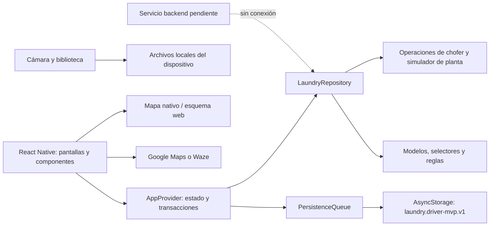
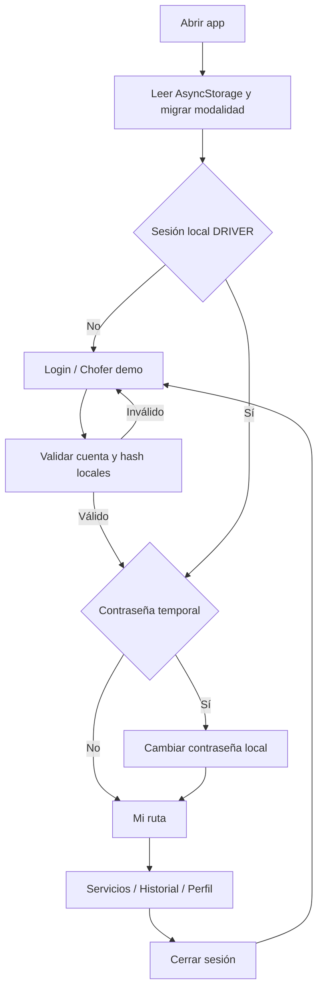
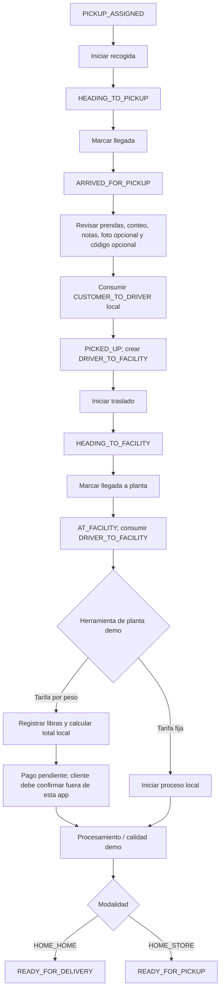
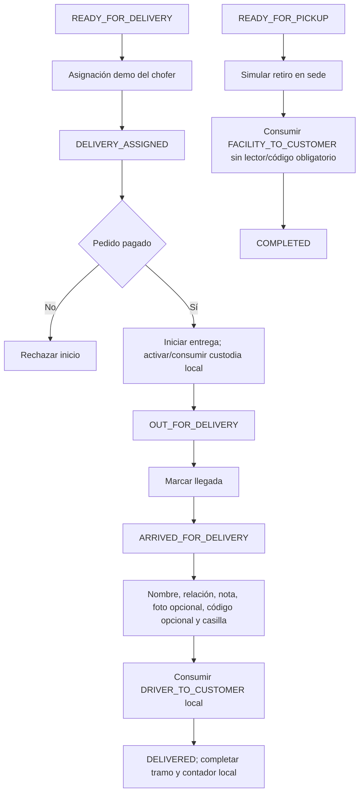
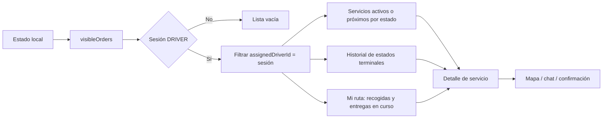
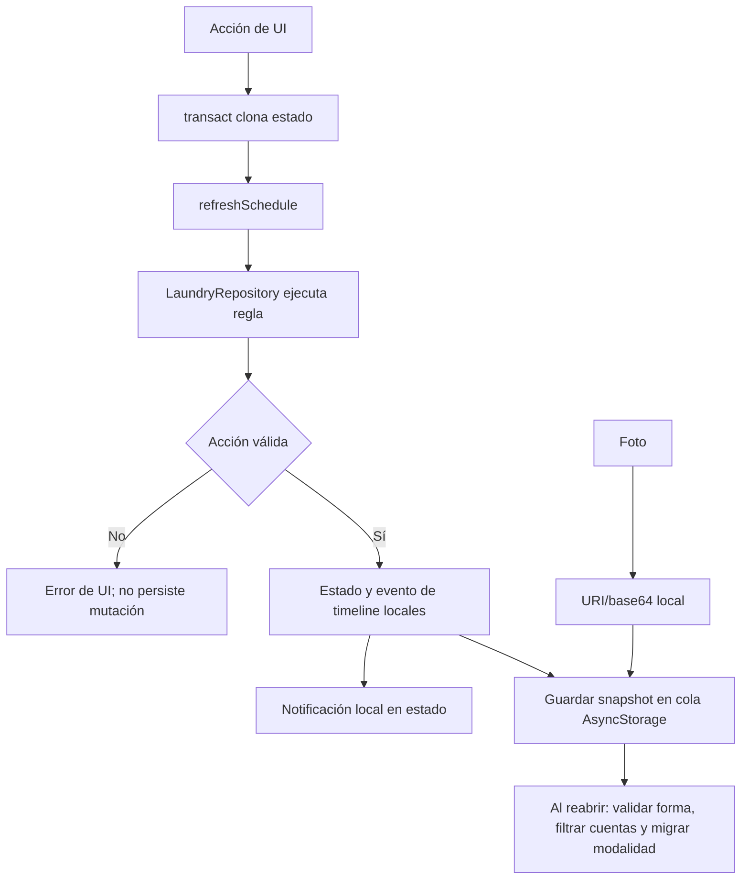

# Diagramas de flujos y relaciones de LaundryDriver

Las flechas describen lógica presente en el código móvil. Las etapas de planta, mensajes y persistencia son locales; los diagramas no representan integración entre aplicaciones.

## 1. Componentes y datos

## 2. Acceso y selección de flujo

## 3. Recogida, transferencia y planta

## 4. Entrega a domicilio y retiro en sede

## 5. Visibilidad y filtros

## 6. Datos y efectos

La migración conserva como legado los ingresos antiguos de cliente en sede y transforma los pedidos abiertos a recogida domiciliaria. La transferencia histórica puede permanecer registrada, pero ya no se ofrece como modalidad nueva.
